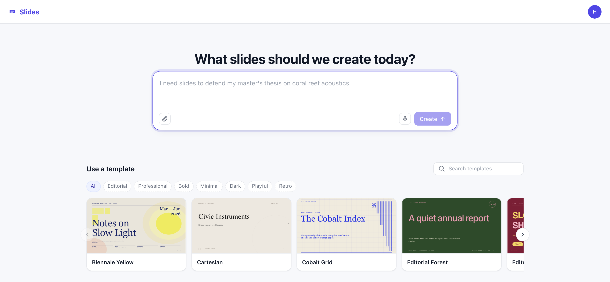

# Slides

A deck is a conversation. Ask for a presentation and the agent designs it — structure first, then
a style system, then slide by slide — and everything it makes is yours to edit.

Launch it from **Starter Kits** in the HarnessRouter console. That provisions the Harness this app
talks to; nothing else is deployed and nothing is configured.

## The first screen

Launch it and this is the first screen: one box, and a shelf of templates if you would rather
start from a look than from a blank page. A template is a **style system** — type scale, palette,
layout rules — not a fixed set of slides, so asking for eleven slides in a five-slide template
gets you eleven slides that match.

What comes back is a deck of real objects — text frames, shapes, images, tables — each one
selectable, editable and restylable. The agent is a very good first draft, not a rendering
service: nothing it makes is a flat picture you have to ask it to change.

## How it works

- **One session is one deck.** The deck list is this Harness's session list, and a deck's content
  is `deck.json` in that session's workspace. There is no database.
- **The app is served by the HarnessRouter image** at `/kits/slides`, same-origin with the
  console, which is why it needs no API key and no login of its own.
- **The deck is JSON on a fixed 1920×1080 stage.** Every slide and element carries a stable id and
  an absolute `frame{x,y,w,h,rotation}`, so the same renderer drives the canvas, the filmstrip
  thumbnails and the print view.

## Run it on your own hosting (preview)

Remote mode is in preview and not released yet. It runs the same app on your own hosting, such as
Vercel, against your Slides Harness on HarnessRouter Cloud. The page and one server route deploy
together from `app/`, and your API key stays on the server.

1. In HarnessRouter, make a workspace for this app and launch Slides in it. Set a cost cap per task
   under Runtime limits in the Slides Harness's settings, then create an API key for that workspace.
2. In `app/`, run `npm ci` and then `npm run remote:setup`. It checks the key, then generates the
   app's password and cookie secret into `app/.env.local`, readable by you only.
3. Create a Vercel project from this repository with `kits/slides/app` as its root directory. Add
   the five values from `app/.env.local` as environment variables, and deploy.
4. Share the password with the people who should use the app. To sign everyone out, set a new
   `KIT_COOKIE_SECRET`.

To try it on your machine first: `npm run build`, then `npm run remote:dev`.

What protects the key:

- Nothing but the sign-in page is served without the password. A signed-in browser holds a
  12-hour cookie that only this app's server can read and check.
- The server route forwards only the calls this app makes, adds the key on the server, and runs
  every task on the Slides Harness, whatever the browser asks for.
- A build whose output carries the key, the password or the cookie secret is refused.

What to know:

- Everyone with the password shares the app, and sees the same decks, as a team does.
- Vercel limits a request to 4.5 MB, so an attachment larger than about 4 MB cannot be sent.
- A turn streams through a function that Vercel stops at its maximum duration (300 seconds in
  `vercel.json`). A plan that allows longer functions can raise it.
- The terms in [License](#license) apply wherever the app runs.

## What's in the folder

| Path | What |
|---|---|
| `kit.json` | The Harness this kit needs, and where its app is served |
| `plugin/skills/slide-design/` | How to design a deck — read before any slide is written |
| `templates/templates.json` | 46 starting points |
| `app/` | The UI |

Template credits are in [CREDITS.md](./CREDITS.md).

## License

Slides is a separately licensed production kit and is not covered by the repository's MIT License.

- Individual local use is free under the [HarnessRouter Starter Kit License Agreement](../LICENSE.md).
- **On HarnessRouter Cloud, the license comes with your account.** With HarnessRouter Cloud as the backend, you may use this kit inside your organization and to serve your own customers and end users, paid deliverables included, with no separate kit fee, Direct User limit or commercial agreement. Cloud plan and usage charges apply. This holds when you host the app yourself, as long as the Harness runs on HarnessRouter Cloud.
- Self-hosted internal use is free for up to three Direct Users. A paid entitlement is required before a fourth Direct User begins use or for separately metered automation.
- **With a self-hosted backend, commercial use needs a paid agreement.** Selling, deploying, hosting or providing an End Product to an external customer, and creating paid Client Deliverables, require the [Commercial Use and Deployment Agreement](../COMMERCIAL-DEPLOYMENT-AGREEMENT.md) and an [Order Form](../ORDER-FORM-TEMPLATE.md).
- Handing kit source code or continued development rights to a customer requires that agreement on any backend.
- Sharing materials about your own business with investors, customers, advisers, and other counterparties is not Commercial Use merely because an external person receives them.
- Third-party templates, fonts, and dependencies remain subject to their own notices and licenses in [CREDITS.md](./CREDITS.md) and the relevant vendored files.
